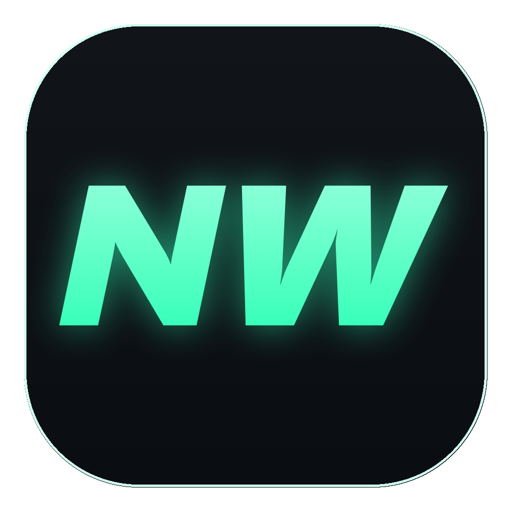

<p align="center">
  
</p>

<h1 align="center">NG Worker</h1>
<p align="center">Облік купівель, продажів і прибутку для українського сервера <b>NG GTA 5 RP</b>.<br/>Десктопний застосунок для Windows у стилі ігрового маркету.</p>

---

## Що вміє

- **Угоди** — записуєте, що купили і за скільки продали. Ціну можна вводити коротко: `15к`, `1.2кк`.
- **Прибуток за FIFO** — собівартість рахується за першими купленими партіями, з урахуванням комісії маркету.
- **Склад** — усе, що куплено й ще не продано, з середньою ціною і вкладеною сумою.
- **Огляд** — чистий прибуток, оборот, витрати, % вдалих продажів, графік прибутку за 7/30 днів чи весь час, топ предметів.
- **Каталог з фото** — 360+ предметів, 160+ одиниць транспорту з характеристиками і фото з автосалону, взуття з усіма кольорами.
- **Свої предмети** — будинки, бізнеси, номери, SIM-картки чи будь-що інше зі своїм фото (клік, перетягування або Ctrl+V).
- **Обране**, пошук, фільтри, сортування — як на маркеті в грі.
- **Резервні копії** — експорт/імпорт у `.json` + автоматична щоденна копія (останні 10 днів).

Гарячі клавіші: `Ctrl+N` — нова угода, `Backspace` / `Alt+←` — назад.

## Встановлення

Завантажте з [Releases](https://github.com/scarrymany/ng-worker/releases/latest):

- `NG-Worker-1.0.0-Setup.exe` — інсталятор (рекомендовано);
- `NG-Worker-1.0.0-Portable.exe` — одним файлом, без встановлення.

Потрібен Windows 10/11 з WebView2 (у Windows 11 вже є).

Дані зберігаються локально: `%APPDATA%\com.scarrymany.ngworker\`.

## Збірка з коду

Потрібні [Node.js 20+](https://nodejs.org) і [Rust](https://rustup.rs) (MSVC toolchain).

```bash
npm install
npm run app     # запуск у режимі розробки
npm run dist    # інсталятор у src-tauri/target/release/bundle/nsis
```

Стек: **Tauri 2 (Rust)** + React 18 + TypeScript + Vite + Framer Motion.

## Джерела даних

- Фото й назви предметів — публічна вікі [ng-gta5.com](https://ng-gta5.com/wiki).
- Транспорт (характеристики, фото з автосалону) та одяг — [NG Base](https://ngbase.fanwiki.top).
- Частина фото транспорту й нових предметів — скриншоти внутрішньоігрового маркету.

Фанатський проєкт, не пов'язаний з адміністрацією NG. Усі ігрові матеріали належать їхнім власникам.

## Ліцензія

MIT
